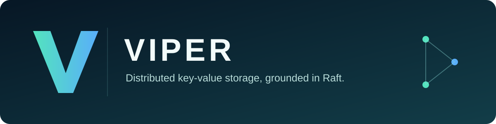
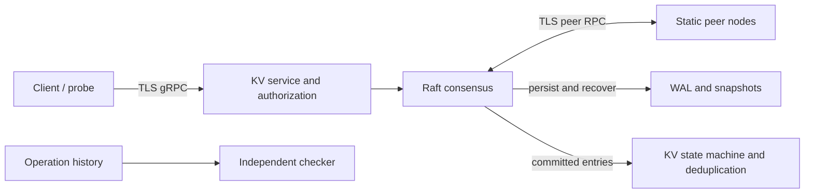
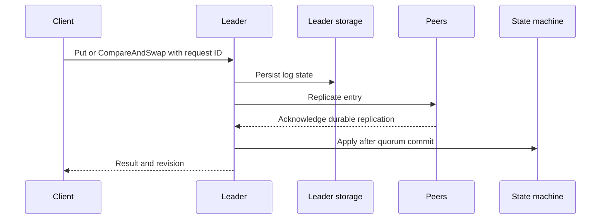

<div align="center">
  
  <h1>Viper</h1>
  <p><strong>One ordered log. A replicated key-value store. Failure behavior you can inspect.</strong></p>
  <p>
    
    <a href="https://github.com/Sakthivel-P-cse/Viper/actions/workflows/ci.yml"></a>
    <a href="https://github.com/Sakthivel-P-cse/Viper/stargazers"></a>
  </p>
  <p><a href="#-overview">Overview</a> · <a href="#-how-it-works">How it works</a> · <a href="#-getting-started">Get started</a> · <a href="#-api-reference">API</a> · <a href="#-operations-and-deployment">Operations</a></p>
</div>

---

## 🐍 Overview

Viper is a single-region, Raft-based distributed key-value service for exploring and operating a bounded replicated storage design. It brings consensus, durable recovery, authenticated gRPC, and independent correctness tooling into one Go repository. It is aimed at developers and operators interested in distributed systems and trusted internal workloads.

The local implementation and its tests are not proof of production readiness. Multi-host staging, operational drills, security review, and other release evidence remain outstanding; see [release requirements](docs/release.md).

## ✨ Key features

| Capability | What Viper provides |
| --- | --- |
| Replicated KV | Put, Get, and atomic CompareAndSwap over a static three- or five-node cluster. |
| Explicit consistency | Linearizable reads use a Raft read barrier; stale reads must be explicitly requested. |
| Retry safety | Client and request IDs identify mutations; deduplication state is included in snapshots. |
| Durable recovery | Checksummed WAL, synchronized persistence, snapshots, compaction, and fail-closed corruption handling. |
| Secure boundaries | TLS identity and authorization for clients and peers, validation, and bounded request admission. |
| Verification | An independent bounded linearizability checker and deterministic fault schedules. |
| Operations | Read-only local dashboard, authenticated probe, private metrics option, offline backup and restore, local Compose profile. |

---

## 🧭 How it works

A client connects to the gRPC service with TLS credentials. The leader admits mutations into its Raft log, persists and replicates them, and applies committed commands in order to the key-value state machine. A quorum is required for a mutation to commit. A linearizable read uses a barrier; an explicitly stale read has weaker guarantees. Nodes recover from their local WAL and snapshots. The checker consumes histories separately and is not on the serving path.





On storage failure the open store becomes unhealthy; recovery validates records instead of silently skipping corruption. A valid incomplete WAL payload at the tail may be truncated under the precise rules in the [durability contract](docs/industry-grade/storage.md). Timeouts and leadership changes can leave a mutation's outcome ambiguous: retry using the same client and request IDs.

## 🧰 Tech stack

| Layer | Technology |
| --- | --- |
| Implementation | Go 1.26.11; standard Go tooling |
| RPC and contracts | gRPC, Protocol Buffers, Buf and Protovalidate rules |
| Consensus and storage | In-repository Raft implementation, checksummed WAL and snapshots |
| Deployment | Docker, Compose, Kubernetes starting template |
| Quality | Go race tests, vet, Buf, govulncheck, Gitleaks, GitHub Actions |

## 🗂️ Project structure

```text
.
├── api/                 # Versioned protobuf contracts and generated Go bindings
├── cmd/                 # Viper CLI and contract checker entry points
├── deploy/              # Local Compose profile and Kubernetes template
├── docs/                # Design, durability, runbook, release and examples
├── internal/
│   ├── raft/            # Consensus state machine and runtime
│   ├── storage/         # WAL, recovery, snapshots and backup
│   ├── transport/       # Static cluster and peer transports
│   ├── statemachine/    # KV commands, application and deduplication
│   ├── service/         # Client-facing service orchestration
│   ├── security/        # Identity and authorization
│   ├── observability/   # Health, logging and metrics
│   ├── checker/         # Independent history checker
│   ├── chaos/           # Deterministic fault schedules
│   ├── architecture/   # Dependency boundary tests
│   └── testkit/         # Test infrastructure
├── pkg/                 # Public client and shared contracts
├── assets/              # README artwork
├── Dockerfile           # Non-root runtime image
├── Makefile             # Build and verification commands
└── documentation.md     # Earlier proposal; subordinate to industry-grade docs
```

---

## 🚀 Getting started

### Prerequisites

- Go **1.26.11 or newer**, Git, and network access to download Go modules.
- For the full verification gate: `make`, `rg`, and the pinned tools installed by `make tools`.
- For the local process cluster and generated dashboard configuration: Docker with Compose, OpenSSL, Python 3, and a POSIX shell.

### Install and run the in-memory demo

```bash
git clone https://github.com/Sakthivel-P-cse/Viper.git
cd Viper
go run ./cmd/viper demo
```

The demo starts three in-memory nodes, elects a leader, writes a key, and performs a linearizable read. Its JSON reports `leader`, `found`, and `revision`; it does not start a persistent service.

### Configure a durable service

Copy the shape of [server-config.json](docs/examples/server-config.json), replace all paths and identities with provisioned values, and create the data directory before starting each node. Use the same static membership across nodes. Peer certificates need `urn:viper:node:<id>` URI SANs; client and administrator identities use `urn:viper:client:<id>` and `urn:viper:admin:<id>`. See the [runbook](docs/runbook.md) for setup and operational details.

| JSON field | Purpose / default |
| --- | --- |
| `node_id`, `data_dir` | Node identity and absolute, pre-existing storage directory. |
| `peer_listen`, `client_listen` | Separate peer and client TCP listeners. |
| `peers` | Static member objects with `id`, `address`, and `server_name`. |
| `peer_tls`, `client_tls` | Objects containing `certificate`, `key`, and `ca` file paths. |
| `allowed_clients`, `allowed_administrators` | Authorized certificate identities. |
| `tick_interval_millis` | Raft tick interval; default `50`. |
| `max_concurrent_requests`, `max_requests_per_second` | Public admission limits; defaults `256` and `1000`. |
| `max_in_flight_peer_requests` | Peer request limit; default `64`. |
| `metrics_listen` | Optional metrics listener; keep it private. |
| `shutdown_timeout_millis` | Graceful shutdown timeout; default `5000`. |

The CLI reads JSON configuration rather than application environment variables. Compose uses these optional environment variables:

| Variable | Purpose / default |
| --- | --- |
| `VIPER_UID` | Container UID; `65532` if unset. |
| `VIPER_GID` | Container GID; `65532` if unset. |

```bash
go run ./cmd/viper serve -config /path/to/server.json
```

### Build and test

```bash
make tools      # installs pinned verification tools into .tools/bin
make verify     # format, protobuf contract, vet and race tests
make build      # builds all Go packages
make build-release  # writes dist/viper
```

`make tools` downloads tools and `make verify` needs Buf. See the [development plan](docs/codex-development-plan.md) for phase gates and [release requirements](docs/release.md) for the wider evidence boundary.

## 💻 Usage and CLI reference

Run commands via `go run ./cmd/viper <command>` or use the `dist/viper` binary after `make build-release`.

| Command | Purpose |
| --- | --- |
| `demo` | Run the in-memory election, write and read demonstration. |
| `serve -config path` | Start a configured durable node. |
| `dashboard -config path` | Start the read-only local node status dashboard. |
| `probe -target host:port -server-name name -ca path -certificate path -key path` | Authenticated Put followed by a linearizable Get; writes a probe key. |
| `check-history path` | Check a bounded JSON history for linearizability. |
| `validate-schedule path` | Validate a deterministic chaos schedule. |
| `verify-backup path` | Verify a backup without activating it. |
| `export-backup -data-dir path -output path` | Export an offline store; `-force` permits replacing an existing backup. |
| `restore-backup -data-dir path -backup path` | Restore into a pre-provisioned directory without an existing Viper store. |
| `version` | Print version, commit and build date as JSON. |

For example, a default non-release build reports:

```text
$ go run ./cmd/viper version
{"build_date":"unknown","commit":"unknown","version":"dev"}
```

The [runbook](docs/runbook.md) includes authenticated probe and backup examples. Backup files are checksummed, **not encrypted**; protect them with encrypted, access-controlled storage. Stop the node before offline export.

## 🔌 API reference

Viper exposes versioned **gRPC** services, not HTTP CRUD endpoints. Definitions and field validation are in [api/proto/viper/api/v1](api/proto/viper/api/v1); the typed Go client is in [pkg/client](pkg/client).

| Service / method | Purpose |
| --- | --- |
| `KVService.Put` | Replace a value; supply client and request IDs. |
| `KVService.Get` | Read with `LINEARIZABLE` or `STALE` consistency and receive the revision. |
| `KVService.CompareAndSwap` | Atomically replace a value if its expected presence and value match. |
| `NodeStatusService.GetNodeStatus` | Obtain redacted liveness or readiness and node state. |
| `RaftPeerService.RequestVote` | Peer election RPC. |
| `RaftPeerService.AppendEntries` | Peer log replication RPC. |
| `RaftPeerService.InstallSnapshot` | Peer snapshot transfer RPC. |

KV keys are limited to 4096 bytes and values to 1048576 bytes in the protobuf contract. Mutations require client and request IDs. Peer RPCs are for cluster members; status requests require administrator authorization. Optional `/metrics` is a separate operational HTTP listener, not the data API.

---

## 🐳 Operations and deployment

<details>
<summary><strong>Run the local TLS Compose cluster</strong></summary>

This profile runs three processes on one host; it is an integration environment, not a high-availability claim. Generate development-only certificates and configuration, then start it:

```bash
./deploy/compose/generate-dev-tls.sh
export VIPER_UID=$(id -u)
export VIPER_GID=$(id -g)
docker compose -f deploy/compose/docker-compose.yml up --build -d
docker compose -f deploy/compose/docker-compose.yml ps
```

In another terminal, start the dashboard using the generated configuration:

```bash
go run ./cmd/viper dashboard -config .runtime/config/dashboard.json
```

Open `http://127.0.0.1:8080`. The dashboard is read-only and loopback-only; it reports liveness and readiness separately. A failed refresh labels retained liveness observations as stale. TLS handshake failures may appear as unavailable, so check the certificate and connection when troubleshooting. Node observations do not prove quorum. Stop the dashboard with Ctrl+C.

Stop the cluster with `docker compose -f deploy/compose/docker-compose.yml down`. Generated `.runtime/` files include private keys; do not reuse the certificates outside local testing. See the [Compose guide](deploy/compose/README.md).

</details>

The [Dockerfile](Dockerfile) builds a non-root distroless image. The [Kubernetes template](deploy/kubernetes/README.md) is a starting point requiring deployment-owned certificates, encrypted storage, a signed pinned image, and an authenticated readiness check. Mixed-version rolling upgrades are not supported; follow the [maintenance upgrade boundary](docs/compatibility.md).

GitHub Actions runs `make verify`, dependency and secret scans, build and benchmark smoke checks, then builds the container image. Benchmark smoke checks are not performance guarantees; see [benchmarks](docs/benchmarks.md).

## ⚖️ Design decisions and limitations

- **Static membership:** changing one node's peer list is not a membership-change protocol; joint consensus is not implemented.
- **Single region and bounded scope:** no multi-region consensus, SQL, cross-key transactions, or etcd compatibility claim.
- **Recovery first:** one process owns each data directory; the filesystem must support `fsync` and atomic same-directory rename. Backups restore to a separate directory.
- **Explicit consistency:** stale reads are opt-in; a missing quorum cannot safely acknowledge a mutation.
- **Bounded evidence:** the checker handles bounded histories, and local tests or a single-host cluster do not establish production availability, SLOs, or hardware performance.
- **Compatibility:** mixed-version upgrades lack a tested compatibility matrix. The local module path `viper` is not yet a stable published import path.

The [industry-grade design](docs/industry-grade/design.md) and [storage contract](docs/industry-grade/storage.md) take precedence over the older proposal in `documentation.md`.

## 🛣️ Roadmap

The [development plan](docs/codex-development-plan.md) records the completed implementation phases and remaining release gate. Remaining evidence includes multi-host staging, failure and restore drills, target-hardware benchmarks and soak tests, certificate rotation, external security review, signed artifacts, and monitoring integration. Dynamic membership and mixed-version compatibility require separate design and verification.

## 🤝 Contributing

Read [AGENTS.md](AGENTS.md), the [development plan](docs/codex-development-plan.md), and the relevant design and storage documents before changing behavior. Keep changes within the documented contracts and run the relevant checks; `make verify` is the standard local gate. Explain limitations and evidence in contributions.

## 📄 License and acknowledgements

No license file is present in this repository. **TODO:** maintainers should add a license before reuse terms can be stated.

Viper builds on the Raft consensus model and the Go, gRPC, Protocol Buffers, and Buf ecosystems. See their respective project documentation for background and licensing.
