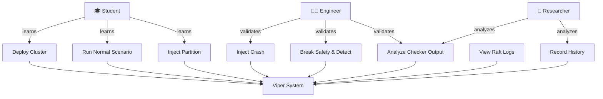
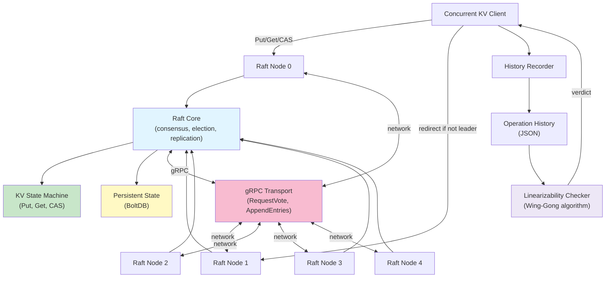
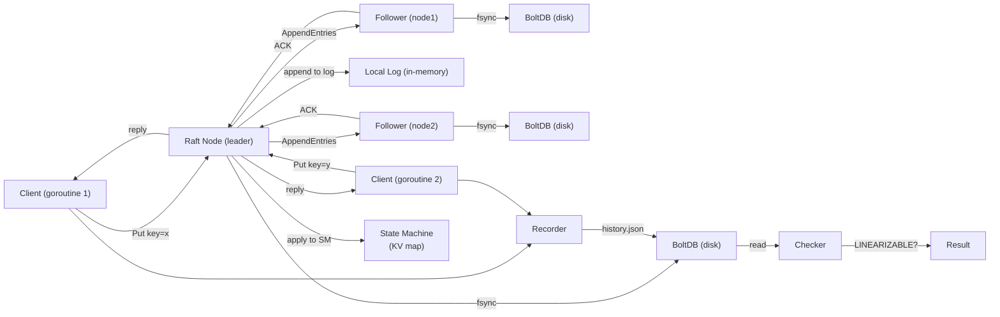
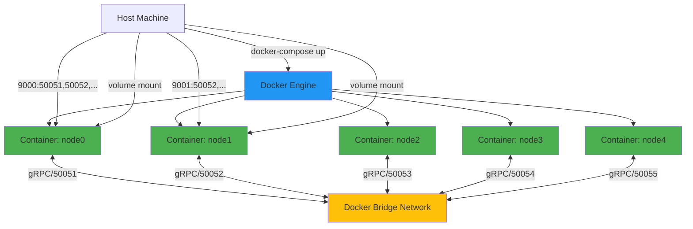
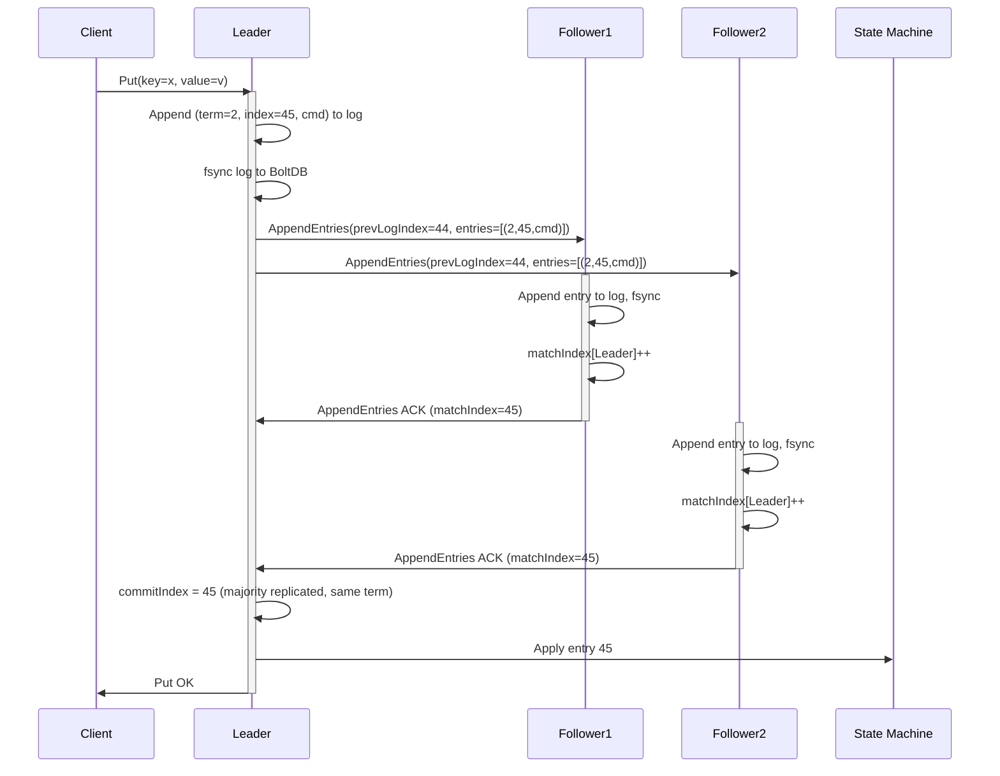
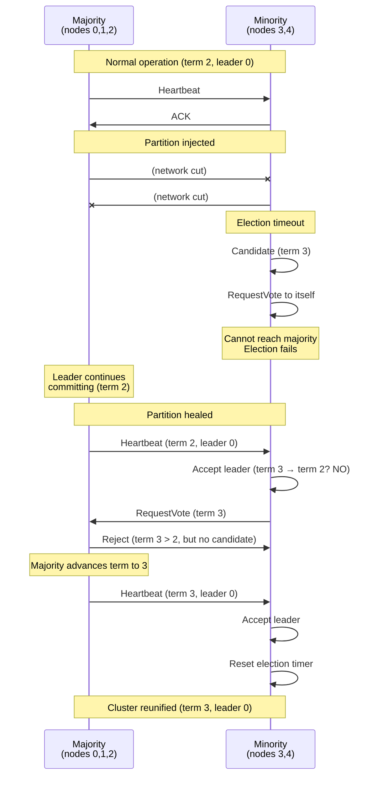
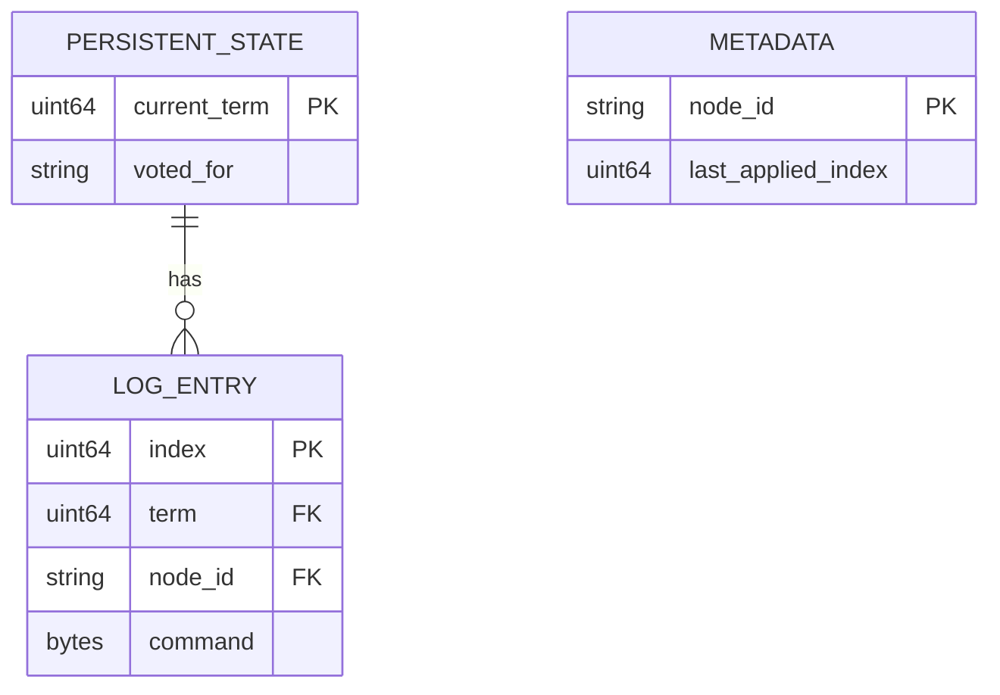

# Viper Project — Complete Documentation Suite

---

# 1. Project Proposal

**Project Name:** Viper — A Linearizable Raft KV Store with Formal Correctness Verification

**Date:** [TO BE CONFIRMED]  
**Version:** 1.0  
**Author:** [TEAM MEMBERS TO BE CONFIRMED]

## 1.1 Executive Summary
Viper is an educational distributed key-value store built on the Raft consensus algorithm, paired with a formal linearizability checker that **proves** the system satisfies correctness guarantees under real-world failure scenarios. Unlike typical Raft implementations that rely on testing, Viper includes a Wing-Gong-style verification harness that formally checks whether observed operation histories are linearizable — and deliberately breaks safety guarantees to demonstrate the checker catches violations.

## 1.2 Problem Statement
**Current gap:** Most software engineers learn consensus algorithms (like Raft) from papers or toy implementations, but never build a system that:
- Handles real failures (network partitions, node crashes)
- Proves correctness formally, not just via testing
- Includes a verification tool that can detect subtle safety violations

This leaves a gap between "I understand Raft in theory" and "I've built and verified a production-grade consensus system."

## 1.3 Objectives
1. Build a working Raft-based KV store from scratch (no external consensus libraries)
2. Implement a formal linearizability checker independent of the KV store itself
3. Create a chaos testing harness that proves the system and checker work under adversarial conditions
4. Provide an educational resource demonstrating CP vs. AP tradeoffs in distributed systems

## 1.4 Scope

**In scope:**
- Raft consensus layer (leader election, log replication, safety rules)
- Persistent state (currentTerm, votedFor, log entries) using BoltDB
- 5-node cluster via Docker Compose
- Concurrent KV client with operation history recording
- Linearizability checker (Wing-Gong algorithm with memoization)
- Chaos suite: network partitions, node crashes, deliberate safety violations
- Complete documentation and deployment guide

**Out of scope:**
- Advanced optimizations (leadership transfer, log compaction, snapshot optimization)
- Machine learning-based anomaly detection
- Cloud deployment or multi-region replication
- Production-grade observability (monitoring, tracing)

## 1.5 Target Users
- Software engineering students learning distributed systems
- Backend engineers preparing for distributed-systems interviews
- Researchers studying formal verification of consensus algorithms
- Teams building custom consensus-based systems

## 1.6 Expected Outcomes
- A working, verified Raft cluster deployable on a local PC
- Proof that network partitions and node crashes are handled correctly
- Evidence that the linearizability checker detects safety violations when they occur
- Clear documentation of the CAP tradeoff (this project chooses CP; contrast with availability-first systems)

---

# 2. Feasibility Study

**Project Name:** Viper  
**Date:** [TO BE CONFIRMED]  
**Version:** 1.0

## 2.1 Technical Feasibility

| Component | Feasibility | Rationale |
|---|---|---|
| Raft consensus layer | **High** | Well-documented algorithm; Go language well-suited to concurrency |
| BoltDB persistence | **High** | Mature, embedded key-value store; no external database required |
| Linearizability checker | **Medium-High** | Wing-Gong algorithm is known, but state-space search can be complex; memoization makes it practical |
| Docker Compose cluster | **High** | Standard tooling; 5-node cluster is trivial to orchestrate locally |
| Chaos harness (partitions, crashes) | **High** | Reuses proven patterns from prior projects (interceptor-based partition, process kill/restart) |
| gRPC transport | **High** | Mature ecosystem; straightforward RPC implementation |

**Conclusion:** Technically feasible with moderate complexity in the linearizability checker.

## 2.2 Resource Feasibility

| Resource | Availability | Notes |
|---|---|---|
| Development environment | **Available** | Go 1.22+, Docker, Docker Compose (free, open-source) |
| Time | **[TO BE CONFIRMED]** | Estimated 4-6 weeks for a single developer |
| Knowledge | **Available** | Distributed systems background assumed; Raft paper is reference |
| Hardware | **Available** | Local PC sufficient for 5-node cluster; minimal resource footprint |
| Libraries | **Available** | gRPC, BoltDB, Protocol Buffers all open-source, well-maintained |

**Conclusion:** Resource-feasible for a college project timeline.

## 2.3 Operational Feasibility

| Aspect | Status | Notes |
|---|---|---|
| Local deployment | **Feasible** | Docker Compose handles orchestration; no cloud infrastructure needed |
| Maintenance | **Feasible** | Single-machine deployment; standard debugging and logging |
| Testing | **Feasible** | Chaos suite runs locally; no external dependencies for test execution |
| Reproducibility | **Feasible** | All chaos scenarios are deterministic; results repeatable |

**Conclusion:** Operationally feasible for local development and testing.

## 2.4 Risk Assessment

| Risk | Probability | Impact | Mitigation |
|---|---|---|---|
| Linearizability checker state-space explosion | Medium | High | Implement memoization aggressively; pre-define maximum history size for testing |
| Race conditions in Raft core | Low | Critical | Extensive use of Go's race detector; thorough code review against Raft paper |
| Docker networking complexity | Low | Medium | Use Docker Compose's built-in networking; test partition logic early |
| Persistence correctness | Low | Critical | Run existing tests for BoltDB; verify fsync behavior on every state mutation |

**Conclusion:** Risks are manageable with standard engineering practices.

## 2.5 Recommendation
**PROCEED** with development. Technical and resource feasibility are high; identified risks are mitigable.

---

# 3. Business/Product Requirements Document

**Project Name:** Viper  
**Date:** [TO BE CONFIRMED]  
**Version:** 1.0

## 3.1 Product Vision
Viper is an educational platform that makes distributed-systems correctness tangible and verifiable. Instead of "trust the Raft paper," users can see for themselves: a working Raft cluster, deliberate faults injected, and formal proof that the system responds correctly or fails predictably.

## 3.2 Target Audience & User Personas

### Persona 1: Engineering Student
- **Goal:** Understand how Raft actually works in practice
- **Pain point:** Textbook explanations are abstract; existing implementations are production-grade and hard to follow
- **How Viper helps:** Clean, educational codebase; step-by-step demos showing failure scenarios

### Persona 2: Interview Candidate
- **Goal:** Demonstrate deep understanding of distributed systems in technical interviews
- **Pain point:** Building a toy Raft is common; building and verifying one formally is rare
- **How Viper helps:** Strong portfolio project that goes beyond typical "I implemented Raft"; formal verification story is differentiating

### Persona 3: Systems Engineer
- **Goal:** Understand tradeoffs between consistency models (CP vs. AP) for their own systems
- **Pain point:** Theory doesn't directly translate to practice; easy to misunderstand when to use each model
- **How Viper helps:** Side-by-side comparison with an AP system (the CRDT rate limiter); clear tradeoff documentation

## 3.3 Key Features

| Feature | Description | Priority |
|---|---|---|
| **Raft Consensus** | Full Raft implementation: leader election, log replication, term-safety rules | **Must Have** |
| **KV Store** | Simple Put/Get/CompareAndSwap operations over replicated state machine | **Must Have** |
| **Linearizability Checker** | Formal verification that operation histories satisfy linearizability | **Must Have** |
| **Chaos Testing** | Network partitions, node crashes, deliberate safety violations | **Must Have** |
| **Docker Cluster** | 5-node cluster deployable locally via Docker Compose | **Must Have** |
| **Client Library** | Concurrent KV client with operation history recording | **Must Have** |
| **Documentation** | Architecture guide, chaos suite explanation, CAP comparison | **Must Have** |
| **Interactive Demo** | 4-act scenario showing normal operation, crashes, partitions, and safety violations | **Should Have** |
| **Performance Benchmarks** | Throughput, latency, overshoot under load | **Could Have** |

## 3.4 Success Criteria
- [ ] Raft cluster runs without crashes for at least 1 hour of continuous operation
- [ ] Linearizability checker confirms all normal operation histories are linearizable
- [ ] Deliberately breaking the term-safety rule causes checker to report violations
- [ ] Network partition splits majority/minority correctly; majority commits, minority does not
- [ ] Leader crash triggers election; new leader emerges without data loss or conflicting entries
- [ ] 4-act demo runs end-to-end with clear, reproducible output
- [ ] All code is deployable on a local PC with Docker installed

## 3.5 User Workflows

### Workflow 1: Run a Normal Scenario
1. User starts the 5-node Docker cluster via `docker-compose up`
2. Client issues concurrent Put/Get operations
3. System records full operation history
4. User runs `./demo normal` — verifies all operations succeeded
5. Linearizability checker confirms history is linearizable
6. User sees: `LINEARIZABLE ✓`

### Workflow 2: Inject a Partition and Observe Behavior
1. User runs `./demo partition`
2. Network partition splits cluster into majority (3 nodes) and minority (2 nodes)
3. Majority side continues accepting writes; minority rejects them
4. After 30 seconds, partition is healed
5. Minority catches up with majority's log
6. Linearizability checker confirms entire history is linearizable
7. User sees: `LINEARIZABLE ✓ (with partition recovery)`

### Workflow 3: Break Safety and Detect the Violation
1. User runs `./demo unsafe-commit`
2. Term-safety rule is disabled via feature flag
3. Scenario: leader changes during replication; a previously-committed write gets overwritten
4. Linearizability checker analyzes the history
5. Checker reports: `LINEARIZABLE ✗ — violation detected at [specific operations]`
6. User sees concrete proof the safety rule matters

## 3.6 Non-Functional Requirements

| Requirement | Specification | Rationale |
|---|---|---|
| **Correctness** | All committed data must survive crashes; no silent data loss | Fundamental property of a consensus system |
| **Availability (under partition)** | Majority partition commits; minority rejects | CP system by design; explicit tradeoff |
| **Latency** | Leader election < 500ms; write replication < 100ms (local network) | Acceptable for educational demo |
| **Scalability** | Support 5 nodes; checker handles histories up to ~1000 operations | Sufficient for local PC; document limits |
| **Deployability** | Single `docker-compose up` command starts the cluster | Ease of use for students |
| **Verifiability** | Linearizability checker output is deterministic and reproducible | Trust in verification results |

---

# 4. Software Requirements Specification (SRS)

**Project Name:** Viper  
**Date:** [TO BE CONFIRMED]  
**Version:** 1.0

## 4.1 Functional Requirements

### 4.1.1 Raft Consensus Layer
| Requirement ID | Description | Priority |
|---|---|---|
| RFC-001 | Implement leader election with randomized timeouts (150-300ms) | Must Have |
| RFC-002 | Implement log replication via AppendEntries RPC | Must Have |
| RFC-003 | Implement term-based safety (reject stale terms, advance on newer terms) | Must Have |
| RFC-004 | Implement commit-index advancement with term-safety rule (critical: leader only commits current-term entries directly) | Must Have |
| RFC-005 | Persist currentTerm, votedFor, and log to disk before responding to RPCs | Must Have |
| RFC-006 | Handle follower log matching correctly (reject if prevLogTerm/prevLogIndex mismatch) | Must Have |
| RFC-007 | Implement election restriction (candidate log must be at least as up-to-date as majority) | Must Have |

### 4.1.2 Replicated State Machine (KV Store)
| Requirement ID | Description | Priority |
|---|---|---|
| KV-001 | Implement Put(key, value) — writes to committed log, applies to state machine | Must Have |
| KV-002 | Implement Get(key) — reads from state machine (or from leader for strict consistency) | Must Have |
| KV-003 | Implement CompareAndSwap(key, expected, new) — atomic conditional write | Must Have |
| KV-004 | Route client requests to current leader; return NotLeader error if queried node is not leader | Must Have |
| KV-005 | Apply committed log entries to state machine in order, never out of order | Must Have |

### 4.1.3 Linearizability Checker
| Requirement ID | Description | Priority |
|---|---|---|
| CHK-001 | Parse recorded operation history (invocation/completion events with timestamps) | Must Have |
| CHK-002 | Implement Wing-Gong algorithm: search for valid sequential ordering explaining observed results | Must Have |
| CHK-003 | Use memoization to avoid re-exploring identical (applied set, model state) pairs | Must Have |
| CHK-004 | Return Linearizable=true if valid ordering found; Linearizable=false + counterexample if not | Must Have |
| CHK-005 | Checker must be independent package with zero imports from Raft/KV code | Must Have |

### 4.1.4 Chaos Testing
| Requirement ID | Description | Priority |
|---|---|---|
| CHX-001 | Inject network partition (specified subset of nodes isolated from rest) | Must Have |
| CHX-002 | Kill and restart a node process; node reloads persistent state on restart | Must Have |
| CHX-003 | Record full operation history across all faults for checker analysis | Must Have |
| CHX-004 | Feature-flag to disable term-safety rule; prove checker detects resulting violation | Must Have |

### 4.1.5 Client & History Recording
| Requirement ID | Description | Priority |
|---|---|---|
| CLI-001 | Concurrent KV client with configurable number of worker goroutines | Must Have |
| CLI-002 | Record precise invocation timestamp (before sending RPC) for each operation | Must Have |
| CLI-003 | Record precise completion timestamp (after receiving response) for each operation | Must Have |
| CLI-004 | Persist history to disk for later checker analysis | Must Have |

## 4.2 Non-Functional Requirements

| NFR ID | Category | Requirement | Target |
|---|---|---|---|
| NFR-001 | Correctness | Zero race conditions detected by `go test -race` | 100% clean |
| NFR-002 | Correctness | Raft safety rules hold under partition and crash scenarios | Proven by checker |
| NFR-003 | Performance | Leader election completes in < 500ms | Measured |
| NFR-004 | Performance | Log replication latency < 100ms on local network | Measured |
| NFR-005 | Scalability | Checker handles operation histories up to ~1000 ops | Documented limit |
| NFR-006 | Deployability | Single `docker-compose up` starts 5-node cluster | No manual setup |
| NFR-007 | Debuggability | Code is readable, follows the Raft paper's structure, minimal clever optimizations | By inspection |
| NFR-008 | Verifiability | Checker results are deterministic and reproducible | Verified by test re-runs |

## 4.3 Module Breakdown

```
raft/
  ├── node.go              # Core state machine (Follower/Candidate/Leader)
  ├── state.go             # Persistent state
  ├── log.go               # Log store interface
  ├── election.go          # RequestVote RPC + election logic
  ├── replication.go       # AppendEntries RPC + replication loop
  ├── commit.go            # Commit index advancement (includes term-safety rule)
  └── transport.go         # Transport interface for RPC

storage/
  ├── boltdb_log.go        # LogStore implementation
  └── boltdb_state.go      # Persistent state storage

kvstore/
  ├── statemachine.go      # In-memory KV map
  └── server.go            # gRPC server (Put/Get/CAS endpoints)

client/
  ├── client.go            # KV client
  └── recorder.go          # History recording

checker/
  ├── history.go           # Data types (Operation, Event, History)
  ├── linearizability.go   # Wing-Gong checker algorithm
  └── model.go             # Abstract KV model

chaos/
  ├── partition.go         # Network partition injection
  ├── crash.go             # Node kill/restart
  └── unsafe_mode.go       # Feature flag for term-safety disabling

cmd/
  ├── node/main.go         # Single node entry point
  └── demo/main.go         # 4-act demo orchestrator

tests/
  ├── linearizability_checker_test.go
  ├── election_safety_test.go
  ├── chaos_partition_test.go
  ├── chaos_leader_crash_test.go
  └── chaos_unsafe_commit_test.go
```

## 4.4 User Roles & Permissions

| Role | Capabilities | Notes |
|---|---|---|
| **Developer** | Start cluster, run demos, analyze checker output, modify code | Primary user during development |
| **Operator** (future) | Start/stop cluster, view logs, trigger manual failure scenarios | Not in scope for college project |
| **Researcher** | Run chaos suite, collect metrics, analyze linearizability violations | Future extension |

## 4.5 Assumptions & Constraints

**Assumptions:**
- Go 1.22+ and Docker are installed on the development machine
- Raft paper is the authoritative reference for algorithm correctness
- 5-node cluster is sufficient to demonstrate consensus and partitions
- Local network is reliable (no random packet loss); chaos is injected deliberately
- Users understand basic distributed systems concepts (consensus, replication, leader election)

**Constraints:**
- Checker state-space search is NP-hard; limited to ~1000 operations per history
- No log compaction or snapshotting (out of scope)
- No cluster membership changes (static 5-node setup)
- All nodes assumed to have synchronized clocks (for timestamp-based real-time ordering)

---

# 5. Use Case Document

**Project Name:** Viper  
**Date:** [TO BE CONFIRMED]  
**Version:** 1.0

## 5.1 Use Case Diagram



## 5.2 Use Case Narratives

### UC1: Deploy Cluster

**Actor:** Student / Engineer  
**Precondition:** Docker and Docker Compose installed  
**Main Flow:**
1. User checks out Viper repository
2. User runs `docker-compose up`
3. System builds container images
4. System starts 5 Raft nodes (node0–node4) in separate containers
5. System initializes persistent state stores (BoltDB files)
6. System starts gRPC servers on ports 50051–50055 (one per node)
7. System starts leader election; one node becomes leader within 500ms
8. User sees: `[node0] Follower elected leader [node2]` in logs

**Postcondition:** 5-node cluster is running, ready to accept client requests  
**Alternative flow:** If Docker not installed, system displays clear error message with install instructions

---

### UC2: Run Normal Scenario

**Actor:** Student / Engineer  
**Precondition:** Cluster is running and healthy  
**Main Flow:**
1. User runs `./demo normal`
2. System spawns concurrent KV client (e.g., 4 workers)
3. Client issues Put/Get/CAS operations to the cluster for 30 seconds
4. System records operation history with precise timestamps
5. All operations complete successfully (no errors)
6. System runs linearizability checker on recorded history
7. Checker reports: `LINEARIZABLE ✓`
8. User sees: final summary showing operation counts, latency, checker verdict

**Postcondition:** History is verified linearizable; user gains confidence in normal-path correctness  
**Acceptance Criterion:** Checker result is consistent across multiple runs

---

### UC3: Inject Network Partition

**Actor:** Engineer / Researcher  
**Precondition:** Cluster is running; at least 30 seconds of operation history desired  
**Main Flow:**
1. User runs `./demo partition`
2. System spawns concurrent KV client and records operations
3. After 10 seconds of normal operation, system injects partition: isolates nodes 3–4 from nodes 0–2
4. Majority partition (0–2) continues accepting writes and committing them
5. Minority partition (3–4) rejects new writes (NotLeader error)
6. Client retries against majority nodes; all retries succeed
7. After 20 more seconds, partition is healed
8. Minority nodes (3–4) rejoin, receive AppendEntries from new leader, catch up
9. System records full history including partition and healing
10. Checker analyzes history and confirms linearizable
11. User sees: `LINEARIZABLE ✓ (partition + recovery)`

**Postcondition:** Partition tolerance is demonstrated; recovery is verified correct  
**Acceptance Criterion:** No data lost; no conflicting entries in healed log

---

### UC4: Inject Node Crash

**Actor:** Engineer  
**Precondition:** Cluster is running; leader is established  
**Main Flow:**
1. User runs `./demo crash`
2. System records operations for 10 seconds
3. System kills leader node (via `docker kill`)
4. Leader is unavailable; new election is triggered in remaining nodes
5. One of the remaining nodes becomes new leader within 500ms
6. Client redirects to new leader; operations resume
7. After 20 seconds, killed node is restarted (via `docker restart`)
8. Restarted node reloads persistent state from BoltDB
9. Restarted node rejoin as follower; receives AppendEntries from leader
10. Checker analyzes full history
11. User sees: `LINEARIZABLE ✓`

**Postcondition:** Crash recovery is demonstrated; no data loss or duplicate commits  
**Acceptance Criterion:** Restarted node correctly rejoins without violating safety

---

### UC5: Break Safety Rule & Detect Violation

**Actor:** Engineer / Researcher  
**Precondition:** Cluster is running; feature flag `UNSAFE_COMMIT_MODE` is enabled  
**Main Flow:**
1. User runs `./demo unsafe-commit` (passes feature flag to disable term-safety check)
2. System starts cluster with disabled term-safety rule in commit-index advancement
3. System records operations for 10 seconds (normal scenario)
4. System injects partition to trigger leader change
5. Under the broken safety rule, a previously-committed write can be overwritten during log sync
6. Checker analyzes history
7. Checker reports: `LINEARIZABLE ✗ — violation at operation [ID]: [description of conflicting operations]`
8. User sees concrete evidence the safety rule matters

**Postcondition:** User understands why the term-safety rule is critical  
**Acceptance Criterion:** Checker reliably detects the violation; no false negatives

---

### UC6: Analyze Checker Output

**Actor:** Researcher / Engineer  
**Precondition:** Checker has run on a history  
**Main Flow:**
1. System outputs checker results to stdout and JSON file
2. User reads human-readable verdict: `LINEARIZABLE ✓` or `LINEARIZABLE ✗`
3. If not linearizable, user reads counterexample: specific operations whose results are inconsistent
4. User correlates counterexample to events in the Raft logs (leader changes, partitions, crashes)
5. User adjusts chaos scenario or reviews code based on findings

**Postcondition:** User has clear understanding of where correctness succeeded or failed  
**Acceptance Criterion:** Counterexamples are specific enough to trace root cause

---

### UC7: View Raft Logs

**Actor:** Student / Engineer  
**Precondition:** Cluster has been running for some time  
**Main Flow:**
1. User runs `./inspect logs node0`
2. System reads persistent log from node0's BoltDB
3. System displays:
   - Current term
   - Voted-for record
   - Full log entries with term and index
   - Commit index
4. User can compare logs across nodes to see replication lag, conflicts, etc.

**Postcondition:** User has detailed visibility into Raft internal state  
**Acceptance Criterion:** Log format is readable; all fields are displayed

---

### UC8: Record Operation History

**Actor:** Researcher / Client code  
**Precondition:** KV client is running  
**Main Flow:**
1. Client library records every operation:
   - Invocation event: exact timestamp before RPC
   - Operation details: key, value, operation type
   - Completion event: exact timestamp after response
   - Result: success/failure, returned value
2. History is streamed to file (one event per line, JSON format)
3. Checker later reads this file for analysis

**Postcondition:** Complete history is persisted for deterministic analysis  
**Acceptance Criterion:** History is timestamped accurately; checker can parse it

---

## 5.3 Actor Summary

| Actor | Goals | Frequency | Tech Savviness |
|---|---|---|---|
| **Student** | Learn how Raft works; understand consensus tradeoffs | Weekly during course | Moderate |
| **Engineer** | Validate correctness; prepare for interviews; understand CP vs. AP | Ad hoc | High |
| **Researcher** | Analyze failure modes; study linearizability | As needed for paper/thesis | High |

---

# 6. UI/UX Design Description

**Project Name:** Viper  
**Date:** [TO BE CONFIRMED]  
**Version:** 1.0

## 6.1 User Interface Overview

Viper is a **command-line application** with no GUI. All interaction is through:
- Terminal commands (bash)
- Configuration files (YAML, environment variables)
- Log output (stdout, structured JSON files)
- Docker Compose for cluster orchestration

### Why CLI, not GUI?
- Educational focus: emphasis on understanding internals, not clicking buttons
- Simplicity: reproducible, scriptable, version-controllable
- Focus: no time spent on UI polish; effort goes to core system correctness

## 6.2 Command Structure

```bash
# Start the cluster
docker-compose up

# Run demo scenarios
./demo normal           # Normal operation
./demo partition        # Network partition
./demo crash            # Node crash + recovery
./demo unsafe-commit    # Break safety & detect violation

# Inspect state
./inspect logs node0    # View Raft logs
./inspect state node0   # View term, votedFor
./inspect history       # View recorded operation history

# Cleanup
docker-compose down
```

## 6.3 Log Output Format

### Normal Operation
```
[node0] 2026-01-15T10:30:45Z [INFO] Starting node node0
[node0] 2026-01-15T10:30:46Z [INFO] Follower
[node0] 2026-01-15T10:30:48Z [INFO] Election timeout triggered
[node0] 2026-01-15T10:30:48Z [INFO] Candidate → RequestVote sent to 4 peers
[node2] 2026-01-15T10:30:48Z [INFO] Granting vote to node0 (term 1)
[node3] 2026-01-15T10:30:48Z [INFO] Granting vote to node0 (term 1)
[node0] 2026-01-15T10:30:49Z [INFO] Leader elected (term 1)
[node1] 2026-01-15T10:30:49Z [INFO] New leader: node0 (term 1) → Follower
```

### Partition Scenario
```
[partition] 2026-01-15T10:31:00Z Isolating nodes 3-4 from nodes 0-2
[node0] 2026-01-15T10:31:00Z [WARN] Lost heartbeat to node3
[node0] 2026-01-15T10:31:00Z [WARN] Lost heartbeat to node4
[node3] 2026-01-15T10:31:02Z [INFO] Election timeout (isolated)
[node3] 2026-01-15T10:31:02Z [INFO] Candidate → RequestVote (minority partition)
[node4] 2026-01-15T10:31:02Z [INFO] Candidate → RequestVote (minority partition)
[node3] 2026-01-15T10:31:03Z [WARN] Election failed (only 2 votes, need 3)
[partition] 2026-01-15T10:31:20Z Healing partition
[node0] 2026-01-15T10:31:20Z [INFO] Heartbeat from node3 restored
[node3] 2026-01-15T10:31:20Z [INFO] New leader: node0 (term 2) → Follower
```

### Checker Output
```
=== Linearizability Checker Results ===
History: 523 operations (42 concurrent clients over 30 seconds)
Checker: Wing-Gong algorithm with memoization
States explored: 1847 (memoized 523 identical states)
Time to verify: 2.3 seconds

Result: LINEARIZABLE ✓

All observed results are consistent with some valid sequential execution.
```

## 6.4 Checker Counterexample Output (violation case)

```
=== Linearizability Checker Results ===
History: 312 operations
Checker: Wing-Gong algorithm

Result: LINEARIZABLE ✗

Violation found:
  Operation 145: [client2] PUT key="x" value="v1" @ time 10.523s
                 result: OK (committed to leader node0)
  
  Operation 201: [client5] GET key="x" @ time 12.104s (after partition healed)
                 result: "" (key not found)
  
  Problem: The PUT at op 145 was acknowledged to the client as committed,
           but subsequent GET at op 201 does not see the value.
           This violates linearizability: committed writes must be visible to all later reads.

Root cause: Term-safety rule was disabled. A prior-term entry was committed directly,
            then overwritten during a leader change.
```

## 6.5 Configuration

Configuration is done via:
1. **Docker Compose** (`.env` file or `docker-compose.yml`)
2. **Environment variables** in node startup
3. **Feature flags** passed as command-line arguments

### Example Configuration
```yaml
# docker-compose.yml
services:
  node0:
    environment:
      - RAFT_ID=node0
      - RAFT_PEERS=node1,node2,node3,node4
      - ELECTION_TIMEOUT_MS=200
      - HEARTBEAT_INTERVAL_MS=50
      - UNSAFE_COMMIT_MODE=false  # Disable for normal operation
      - LOG_LEVEL=INFO

  node1:
    # ... (similar)
```

## 6.6 User Experience Goals

| Goal | Design Decision | Rationale |
|---|---|---|
| **Clarity** | Structured log format with timestamps and severity levels | Users quickly understand what's happening |
| **Reproducibility** | All scenarios are scripted; same command always produces same output | Build trust in system predictability |
| **Debuggability** | Logs are detailed; users can trace cause of each decision | Educational value; learn Raft internals |
| **Automation** | JSON output format for checker; easy to parse for metrics/analysis | Support future research/tooling |

---

# 7. System Architecture Document

**Project Name:** Viper  
**Date:** [TO BE CONFIRMED]  
**Version:** 1.0

## 7.1 High-Level Architecture



## 7.2 Component Architecture

### 7.2.1 Raft Core (`raft/`)

**Responsibility:** Consensus algorithm implementation

**Key Components:**
- `Node`: Main state machine (Follower/Candidate/Leader roles)
- `PersistentState`: currentTerm, votedFor, log (persisted to disk)
- `Election`: RequestVote RPC handling, election timeouts
- `Replication`: AppendEntries RPC, leader replication loop
- `Commit`: Log application, commit-index advancement (includes term-safety rule)
- `Transport`: Interface for RPCs (gRPC implementation)

**Invariants:**
- Persistent state is fsync'd before responding to any RPC
- Log entries are applied in index order to the state machine
- Commit index only advances when a majority has replicated
- A leader never directly commits entries from prior terms

### 7.2.2 KV State Machine (`kvstore/`)

**Responsibility:** Replicated application logic

**Key Components:**
- `StateMachine`: In-memory map of key→value
- `Server`: gRPC endpoints (Put, Get, CompareAndSwap)
- `Apply`: Applies committed log entries to map

**Semantics:**
- Writes go through Raft (leader appends to log, waits for commit)
- Reads can be served from leader directly or with read-index optimization
- All replicas apply same log entries in same order → same final state

### 7.2.3 Persistence (`storage/`)

**Responsibility:** Durable state storage

**Key Components:**
- `BoltDB`: Embedded key-value store for log and term/votedFor
- `LogStore`: Interface for log operations
- `StateStore`: Interface for currentTerm/votedFor

**Design:**
- Each node has a separate BoltDB file
- Every state mutation is fsync'd before RPC responds
- On restart, node reloads state from disk and correctly rejoins cluster

### 7.2.4 Linearizability Checker (`checker/`)

**Responsibility:** Formal verification of correctness

**Key Components:**
- `History`: Recorded operations with timestamps
- `LinearizabilityChecker`: Wing-Gong algorithm
- `KVModel`: Abstract specification of Put/Get/CAS semantics

**Algorithm:**
1. Build partial order of operations from real-time constraints
2. Depth-first search for valid sequential execution
3. Use memoization to prune search space
4. Return verdict + counterexample (if not linearizable)

**Independence:**
- Zero dependency on Raft/KV code
- Can be used to verify any linearizable system
- Reusable as standalone verification tool

### 7.2.5 Client & Recording (`client/`)

**Responsibility:** Test harness for generating load and recording history

**Key Components:**
- `KVClient`: Issues Put/Get/CAS to leader (redirects on NotLeader)
- `Recorder`: Captures invocation/completion timestamps
- `History`: Persists recorded operations to disk

**Concurrency:**
- Multiple worker goroutines issue operations concurrently
- Each operation recorded independently
- History is thread-safe collection

### 7.2.6 Chaos Testing (`chaos/`)

**Responsibility:** Failure injection for verification

**Key Components:**
- `PartitionTransport`: Network partition (reuses interceptor pattern)
- `ProcessKiller`: Kill/restart node processes
- `UnsafeCommitMode`: Feature flag to disable term-safety rule

**Design:**
- Chaos is injected via transport wrapping (not by modifying Raft core)
- Allows testing same code under normal + chaotic conditions
- Safe to enable/disable between scenarios

## 7.3 Data Flow Diagram



## 7.4 Deployment Architecture



## 7.5 Sequence Diagram: Normal Write



## 7.6 Sequence Diagram: Network Partition Recovery



---

# 8. Database Design Document

**Project Name:** Viper  
**Date:** [TO BE CONFIRMED]  
**Version:** 1.0

## 8.1 Data Model Overview

Viper uses **BoltDB**, an embedded key-value store. No external database is required; each node's state is stored in a single local file.

## 8.2 Schema

### 8.2.1 Persistent State Bucket

**Purpose:** Store Raft's critical state (persisted before any RPC response)

**Bucket Name:** `persistent_state`

| Key | Value Type | Description | Constraints |
|---|---|---|---|
| `current_term` | uint64 (big-endian) | Current term (election counter) | Required; >= 0 |
| `voted_for` | string (UTF-8) | Node ID of vote recipient this term | Empty string = no vote; null after term change |

**Schema (pseudo-code):**
```go
type PersistentState struct {
    CurrentTerm uint64 // Persisted before responding to any RPC
    VotedFor    string // Reset to "" on term change
}
```

**Access Pattern:** Read on every RPC (cheap); write before RPC response (fsync mandatory)

---

### 8.2.2 Log Bucket

**Purpose:** Store replicated log entries

**Bucket Name:** `log`

| Key | Value Type | Description | Constraints |
|---|---|---|---|
| `entry:{index}` | serialized LogEntry (protobuf) | Log entry at given index | index >= 1; strictly increasing |

**Schema (pseudo-code):**
```go
type LogEntry struct {
    Term    uint64 // Term in which entry was created
    Index   uint64 // Position in log (1-indexed)
    Command []byte // Serialized KV command (Put, Get, CAS)
}
```

**Indexes:**
- Primary: `entry:{index}` — direct lookup by index
- Secondary: range scan `entry:1` to `entry:N` to iterate log

**Access Patterns:**
- Read: `Get("entry:42")` — check log match during replication
- Append: `Put("entry:100", ...)` — add new entry to end
- Range scan: iterate all entries for snapshot/compaction (out of scope)

---

### 8.2.3 Metadata Bucket

**Purpose:** Store node-specific metadata

**Bucket Name:** `metadata`

| Key | Value Type | Description |
|---|---|---|
| `node_id` | string | This node's Raft ID |
| `last_applied_index` | uint64 | Highest index applied to state machine |

**Access:** Read/write on every apply; low frequency

---

## 8.3 Entity-Relationship Diagram



**Relationships:**
- `current_term` in `PERSISTENT_STATE` is the authoritative term counter
- `LOG_ENTRY.index` uniquely identifies an entry; term is metadata about when it was created
- `METADATA.last_applied_index` tracks progress through log

---

## 8.4 Persistence Guarantees

### 8.4.1 Write-Ahead Logging (WAL)

Every state mutation follows this pattern:
```go
// 1. Serialize new state to bytes
// 2. Write to BoltDB transaction
tx := db.Begin(true)
defer tx.Rollback()

persistentStateBucket := tx.Bucket([]byte("persistent_state"))
persistentStateBucket.Put([]byte("current_term"), term.Bytes())

logBucket := tx.Bucket([]byte("log"))
logBucket.Put([]byte(fmt.Sprintf("entry:%d", index)), entryBytes)

// 3. Commit transaction (triggers fsync)
tx.Commit()

// 4. Only then respond to RPC
RPC.Reply(success=true)
```

**Property:** A node crashes after acknowledging an RPC, then restarts → persisted state is intact on recovery. A node crashes before acknowledging → the RPC is retried.

### 8.4.2 Atomicity

BoltDB transactions are atomic: either all writes in a transaction succeed, or none. This prevents partial state corruption.

Example:
```
Append log entry 42 AND advance commitIndex atomically
```

If crash occurs during the transaction, on restart either both changes are present or neither are.

---

## 8.5 Initialization & Recovery

### On Startup

1. **Open BoltDB file** (`/var/lib/viper/node{id}.db`)
2. **Read currentTerm** → determine this node's current term
3. **Read votedFor** → does not grant duplicate vote in same term
4. **Read log** → restore all entries
5. **Read lastAppliedIndex** → resume applying from there

```go
func (n *Node) Recover() error {
    db, err := bolt.Open(dbPath, 0600, nil)
    if err != nil {
        return err
    }
    
    tx := db.Begin(false)
    defer tx.Rollback()
    
    persistentStateBucket := tx.Bucket([]byte("persistent_state"))
    termBytes := persistentStateBucket.Get([]byte("current_term"))
    n.state.CurrentTerm = binary.BigEndian.Uint64(termBytes)
    
    votedForBytes := persistentStateBucket.Get([]byte("voted_for"))
    n.state.VotedFor = string(votedForBytes)
    
    // Load log entries
    logBucket := tx.Bucket([]byte("log"))
    logBucket.ForEach(func(k, v []byte) error {
        entry := &LogEntry{}
        entry.Unmarshal(v)
        n.state.Log = append(n.state.Log, entry)
        return nil
    })
    
    return nil
}
```

### On Shutdown

Graceful shutdown closes BoltDB transaction and waits for in-flight fsync.

---

## 8.6 Storage Overhead

| Component | Size per Node | Notes |
|---|---|---|
| Metadata | ~100 bytes | Fixed |
| Current term + votedFor | ~16 bytes | Fixed |
| Log entries (per entry) | ~50 bytes + command size | Grows with operation count |
| Estimated total (1000 ops) | ~50 KB | Small enough for local SSD |

---

## 8.7 Backup & Restore

**Backup:** Copy BoltDB file from `node{id}.db`  
**Restore:** Stop node, replace file, restart  
**Frequency:** [TO BE CONFIRMED] for production use

---

# 9. API Documentation

**Project Name:** Viper  
**Date:** [TO BE CONFIRMED]  
**Version:** 1.0

## 9.1 gRPC Service Definition

All RPC definitions are in `proto/raft.proto`.

### 9.1.1 Raft RPCs

#### RequestVote

**Purpose:** Candidate requests votes during leader election

**Request:**
```protobuf
message RequestVoteRequest {
    uint64 term = 1;
    string candidate_id = 2;
    uint64 last_log_index = 3;
    uint64 last_log_term = 4;
}
```

**Response:**
```protobuf
message RequestVoteResponse {
    uint64 term = 1;
    bool vote_granted = 2;
}
```

**Rules:**
- If request term < receiver's term: return {term: receiver.term, vote_granted: false}
- If request term > receiver's term: receiver advances to new term, resets votedFor
- If votedFor is null or equals candidateId, AND candidate's log is at least as up-to-date: grant vote
- Granting a vote resets the election timeout

**Idempotency:** Granting the same vote twice in the same term is safe (idempotent).

---

#### AppendEntries

**Purpose:** Leader replicates log entries and maintains heartbeat

**Request:**
```protobuf
message AppendEntriesRequest {
    uint64 term = 1;
    string leader_id = 2;
    uint64 prev_log_index = 3;
    uint64 prev_log_term = 4;
    repeated LogEntry entries = 5;
    uint64 leader_commit = 6;
}

message LogEntry {
    uint64 term = 1;
    uint64 index = 2;
    bytes command = 3;
}
```

**Response:**
```protobuf
message AppendEntriesResponse {
    uint64 term = 1;
    bool success = 2;
}
```

**Rules:**
- If request term < receiver's term: return {term: receiver.term, success: false}
- If log doesn't contain entry at prevLogIndex with term == prevLogTerm: return {success: false}
- Append any new entries not in log; delete any conflicting entries
- If leaderCommit > receiver's commitIndex: receiver sets commitIndex = min(leaderCommit, index of last new entry)

**Idempotency:** Re-sending the same AppendEntries request produces the same result (safe for retry).

---

### 9.1.2 KV Store RPCs

#### Put

**Purpose:** Write a key-value pair (replicated)

**Request:**
```protobuf
message PutRequest {
    string key = 1;
    string value = 2;
}
```

**Response:**
```protobuf
message PutResponse {
    bool success = 1;
    string error = 2;
    uint64 applied_index = 3;
}
```

**Behavior:**
- Only leader accepts Put requests
- Non-leader returns error: "NOT_LEADER: try node{leader_id}"
- Leader appends entry to log, waits for commit
- Entry is applied to state machine → KV map
- Returns success once entry is committed

**Idempotency:** Same Put request can be issued multiple times; only one KV write occurs (due to log deduplication at the index level, not at the RPC level — client must handle duplicates).

---

#### Get

**Purpose:** Read a key's value (not replicated)

**Request:**
```protobuf
message GetRequest {
    string key = 1;
    bool consistent = 2; // If true, read from leader with read-index optimization
}
```

**Response:**
```protobuf
message GetResponse {
    bool success = 1;
    string value = 2;
    bool not_found = 3;
    string error = 4;
}
```

**Behavior:**
- Any node (leader or follower) can serve Get
- If consistent=false: return value from local state machine (may be stale on followers)
- If consistent=true: leader performs read-index check before responding (ensures we're still leader)
- Returns "" (empty string) if key not found; sets not_found=true

**Consistency:** Weaker than Put (eventual consistency on followers), but leader is always strong-consistent.

---

#### CompareAndSwap (CAS)

**Purpose:** Atomic conditional write

**Request:**
```protobuf
message CompareAndSwapRequest {
    string key = 1;
    string expected = 2;
    string new_value = 3;
}
```

**Response:**
```protobuf
message CompareAndSwapResponse {
    bool success = 1;
    string previous_value = 2;
    string error = 3;
}
```

**Behavior:**
- Only leader accepts CAS
- Reads current value of key
- If current == expected: write new_value (replicated via Raft); return success=true
- If current != expected: return success=false, previous_value=[current]
- Returns error="NOT_LEADER" if queried node is not leader

**Atomicity:** The read + compare + write is atomic with respect to other operations on the same key (enforced by Raft replication).

---

## 9.2 Client Library Usage

### 9.2.1 Basic Example

```go
package main

import (
    "context"
    "fmt"
    "viper/client"
)

func main() {
    // Connect to any node (will redirect to leader)
    c := client.NewClient([]string{"localhost:50051", "localhost:50052"})
    
    // Put
    resp, err := c.Put(context.Background(), "user:1:name", "Alice")
    if err != nil {
        fmt.Printf("Put failed: %v\n", err)
        return
    }
    fmt.Printf("Put succeeded at index %d\n", resp.AppliedIndex)
    
    // Get
    resp2, err := c.Get(context.Background(), "user:1:name", consistent=true)
    if err != nil {
        fmt.Printf("Get failed: %v\n", err)
        return
    }
    fmt.Printf("Value: %s\n", resp2.Value)
    
    // CompareAndSwap
    resp3, err := c.CompareAndSwap(context.Background(), "counter", "10", "11")
    if err != nil {
        fmt.Printf("CAS failed: %v\n", err)
        return
    }
    if resp3.Success {
        fmt.Println("CAS succeeded")
    } else {
        fmt.Printf("CAS failed: current value is %s\n", resp3.PreviousValue)
    }
}
```

### 9.2.2 Error Handling

Common errors:
- `NOT_LEADER`: Node is not the leader; client should retry against a different node
- `TIMEOUT`: RPC did not complete within deadline (likely leader crash or partition)
- `CONTEXT_CANCELLED`: Client cancelled the request

**Client library auto-redirect:** If Put/Get/CAS returns NOT_LEADER error, client attempts to connect to the leader specified in the error message.

---

## 9.3 gRPC Health Check

Health check endpoint (standard gRPC HealthCheck service):
```
/grpc.health.v1.Health/Check
```

Returns `SERVING` if node is alive and Raft core is running.

---

# 10. Project Plan with Milestones

**Project Name:** Viper  
**Date:** [TO BE CONFIRMED]  
**Version:** 1.0  
**Timeline:** [TO BE CONFIRMED] — estimated 6-8 weeks for single developer

## 10.1 Phases and Milestones

| Phase | Duration | Deliverable | Success Criteria |
|---|---|---|---|
| **Phase 1: Raft Core** | 2 weeks | Working Raft cluster (5 nodes) | Leader election in < 500ms; log replication works |
| **Phase 2: KV Store & Persistence** | 1 week | Replicated KV store with BoltDB | Put/Get/CAS operations over Raft; data persists |
| **Phase 3: Linearizability Checker** | 1.5 weeks | Wing-Gong checker implementation | Checker verifies simple histories; memoization reduces search space |
| **Phase 4: Chaos Testing** | 1 week | Partition + crash harness | Network partition splits cluster; node kill/restart works |
| **Phase 5: Demo & Documentation** | 1 week | 4-act demo; complete docs | All docs complete; demo runs end-to-end |
| **Phase 6: Validation & Polish** | 0.5 weeks | Final testing, edge cases | All tests pass; race detector clean |

---

## 10.2 Detailed Timeline

### Week 1–2: Raft Core

**Goal:** Election + basic replication

**Tasks:**
- [ ] Define Raft proto (RequestVote, AppendEntries)
- [ ] Implement Node state machine (Follower/Candidate/Leader)
- [ ] Implement RequestVote handler (election rules)
- [ ] Implement AppendEntries handler (replication rules)
- [ ] Implement election timeout + leader heartbeat
- [ ] Wire gRPC transport
- [ ] Test single leader election among 5 nodes

**Acceptance Criteria:**
- [ ] 5-node cluster starts; one leader emerges within 500ms
- [ ] Leader sends heartbeats to all followers at 50ms interval
- [ ] No race conditions (`go test -race` passes)

---

### Week 3: KV Store & Persistence

**Goal:** Replicated storage with durability

**Tasks:**
- [ ] Design BoltDB schema (persistent state, log, metadata)
- [ ] Implement Put/Get/CAS endpoints
- [ ] Integrate state machine with Raft (apply committed entries)
- [ ] Implement fsync before RPC response
- [ ] Test node crash + recovery (data persists)
- [ ] Test CAS atomicity

**Acceptance Criteria:**
- [ ] Put writes are replicated and durable
- [ ] Get reads from leader return correct values
- [ ] Node crash and restart: log intact, cluster recovers

---

### Week 4: Linearizability Checker

**Goal:** Formal verification algorithm

**Tasks:**
- [ ] Design History data structure (Operation, InvokeEvent, CompleteEvent)
- [ ] Implement KV model (Put/Get/CAS semantics)
- [ ] Implement Wing-Gong search algorithm with memoization
- [ ] Build counterexample reporting
- [ ] Test on hand-crafted valid/invalid histories

**Acceptance Criteria:**
- [ ] Checker confirms a simple sequential history is linearizable
- [ ] Checker detects a manually-constructed non-linearizable history
- [ ] Checker identifies counterexample operations

---

### Week 5: Chaos Testing

**Goal:** Fault injection and verification

**Tasks:**
- [ ] Implement PartitionTransport (reuse interceptor pattern from rate limiter)
- [ ] Implement ProcessKiller (docker kill/restart)
- [ ] Implement unsafe-commit feature flag
- [ ] Write chaos test: partition scenario
- [ ] Write chaos test: leader crash scenario
- [ ] Write chaos test: safety violation detection

**Acceptance Criteria:**
- [ ] Partition splits cluster; majority continues, minority blocks
- [ ] Leader crash triggers new election; recovery is linearizable
- [ ] Breaking safety rule causes checker to report violation

---

### Week 6: Demo & Documentation

**Goal:** End-to-end demo and user-facing docs

**Tasks:**
- [ ] Write all 13 project documents (this file + 12 others)
- [ ] Implement demo orchestrator (4-act scenario)
- [ ] Test demo end-to-end
- [ ] Create Docker Compose file (5-node cluster)
- [ ] Write local deployment guide

**Acceptance Criteria:**
- [ ] `./demo normal/partition/crash/unsafe-commit` all complete
- [ ] All documents are consistent
- [ ] Local deployment works on a fresh machine

---

### Week 7 (optional): Validation & Polish

**Goal:** Final quality checks

**Tasks:**
- [ ] Run full test suite
- [ ] Run go vet and race detector
- [ ] Performance benchmarks (latency, throughput)
- [ ] Code review + cleanup
- [ ] Final documentation review

**Acceptance Criteria:**
- [ ] `go test ./...` and `go test -race ./...` both pass
- [ ] Code follows Raft paper closely; no unexplained deviations
- [ ] README is clear enough for a student to run independently

---

## 10.3 Milestones

| Milestone | Target Date | Gate Criteria |
|---|---|---|
| **M1: Raft Core Working** | End of Week 2 | 5-node cluster, leader elected |
| **M2: KV Store & Persistence** | End of Week 3 | Put/Get/CAS work, data persists |
| **M3: Checker MVP** | End of Week 4 | Checker verifies linearizability |
| **M4: Chaos Testing** | End of Week 5 | Partition + crash tests pass |
| **M5: Demo Runnable** | End of Week 6 | 4-act demo completes end-to-end |
| **M6: Release** | End of Week 7 | All tests pass, code is clean, docs complete |

---

## 10.4 Risk Management

| Risk | Mitigation | Owner | Review Frequency |
|---|---|---|---|
| Raft safety bugs | Code review against paper; race detector; chaos tests | Dev | Weekly |
| Checker search explosion | Implement memoization early; limit history size in tests | Dev | After checker impl. |
| Docker/network complexity | Test partition logic early (week 4); use explicit routing | Dev | End of week 4 |
| Schedule slip | Prioritize core (Raft + Checker); defer polish | PM | Weekly standup |

---

# 11. Test Plan with Test Cases

**Project Name:** Viper  
**Date:** [TO BE CONFIRMED]  
**Version:** 1.0

## 11.1 Testing Strategy

### 11.1.1 Test Levels

| Level | Scope | Tools | Coverage |
|---|---|---|---|
| **Unit** | Single functions (election logic, log append) | Go `testing` package | >80% of core logic |
| **Integration** | Raft layer + KV layer | gRPC over Docker network | End-to-end operation |
| **Chaos** | Fault injection + verification | Partition harness, process kill | Correctness under failures |
| **Formal** | Linearizability verification | Checker algorithm | Proof of correctness |

### 11.1.2 Quality Criteria

- Code coverage: >80% for Raft core, 100% for commit logic (safety-critical)
- Race detector: zero race conditions (`go test -race`)
- Linter: zero warnings (`go vet`)
- Determinism: checker results reproducible across runs

---

## 11.2 Unit Test Cases

### Test: RequestVote Grants Vote to Higher-Term Candidate

**File:** `tests/election_safety_test.go`

**Setup:**
- Node is at term 2, votedFor="", log has 2 entries (term 1: index 1, term 2: index 2)

**Input:**
```
RequestVoteRequest {
    term: 3,
    candidateId: "node-x",
    lastLogIndex: 2,
    lastLogTerm: 2,
}
```

**Expected Output:**
```
RequestVoteResponse {
    term: 3,
    voteGranted: true,
}
```

**Verification:**
- Node's currentTerm is advanced to 3
- votedFor is set to "node-x"
- State is fsync'd to disk

**Test Code:**
```go
func TestRequestVoteGrantsHigherTerm(t *testing.T) {
    node := NewTestNode("node0")
    node.state.CurrentTerm = 2
    node.state.VotedFor = ""
    node.state.Log = []LogEntry{
        {Term: 1, Index: 1, Command: []byte("cmd1")},
        {Term: 2, Index: 2, Command: []byte("cmd2")},
    }
    
    req := &RequestVoteRequest{
        Term: 3,
        CandidateId: "node-x",
        LastLogIndex: 2,
        LastLogTerm: 2,
    }
    
    resp := node.RequestVote(context.Background(), req)
    
    if resp.VoteGranted != true {
        t.Errorf("expected vote granted, got %v", resp.VoteGranted)
    }
    if node.state.CurrentTerm != 3 {
        t.Errorf("expected term 3, got %d", node.state.CurrentTerm)
    }
    if node.state.VotedFor != "node-x" {
        t.Errorf("expected votedFor=node-x, got %s", node.state.VotedFor)
    }
}
```

---

### Test: RequestVote Denies Vote to Lower-Term Candidate

**File:** `tests/election_safety_test.go`

**Setup:**
- Node is at term 3

**Input:**
```
RequestVoteRequest {
    term: 2,
    candidateId: "node-y",
    lastLogIndex: 1,
    lastLogTerm: 1,
}
```

**Expected Output:**
```
RequestVoteResponse {
    term: 3,
    voteGranted: false,
}
```

**Verification:**
- Node's term remains 3
- votedFor is not changed

---

### Test: AppendEntries with Log Mismatch

**File:** `tests/replication_test.go`

**Setup:**
- Node has log: [(term=1, index=1), (term=1, index=2)]
- Receiver is at term 1

**Input:**
```
AppendEntriesRequest {
    term: 1,
    leaderId: "node0",
    prevLogIndex: 3,  // No entry at index 3
    prevLogTerm: 1,
    entries: [(term=1, index=3, cmd)],
    leaderCommit: 0,
}
```

**Expected Output:**
```
AppendEntriesResponse {
    term: 1,
    success: false,
}
```

**Verification:**
- Log is not modified
- No new entry appended

---

### Test: Commit Index Advancement (Term-Safety Rule)

**File:** `tests/commit_test.go`

**Setup:**
- Leader at term 2
- Log: [(term=1, index=1), (term=1, index=2), (term=2, index=3)]
- Majority has replicated entries 1-2 (term=1)
- Majority has replicated entry 3 (term=2)

**Test:**
```go
func TestCommitIndexAdvancedOnlyCurrentTerm(t *testing.T) {
    leader := NewTestLeader("node0", 5) // 5-node cluster
    leader.state.Log = []LogEntry{
        {Term: 1, Index: 1, Command: []byte("a")},
        {Term: 1, Index: 2, Command: []byte("b")},
        {Term: 2, Index: 3, Command: []byte("c")},
    }
    leader.matchIndex["node0"] = 3
    leader.matchIndex["node1"] = 3
    leader.matchIndex["node2"] = 2  // Lagging, only has index 1-2
    leader.matchIndex["node3"] = 2
    leader.matchIndex["node4"] = 2
    
    leader.advanceCommitIndex()
    
    // Majority (nodes 0,1,2) have replicated index 1-2
    // But entry 2 is term=1, leader is term=2
    // Term-safety rule: cannot commit it directly
    // Only entry 3 (current term) should be committed
    
    if leader.commitIndex != 3 {
        t.Errorf("expected commitIndex=3 (only current term), got %d", leader.commitIndex)
    }
}
```

**Expected:** commitIndex advances to 3 only (skips 2 due to term-safety rule)

---

## 11.3 Integration Tests

### Test: Normal Write Path (Write → Commit → Apply)

**File:** `tests/kvstore_integration_test.go`

**Setup:**
- 5-node cluster running, one leader elected
- All nodes connected and healthy

**Scenario:**
1. Client issues `Put("key1", "value1")`
2. Leader appends entry to log
3. Leader sends AppendEntries to followers
4. Followers replicate and ACK
5. Leader advances commitIndex
6. Entry is applied to state machine
7. Client receives OK

**Assertions:**
- [ ] Entry appears in log of all nodes
- [ ] commitIndex advances on leader (entry is replicated to majority)
- [ ] Entry is applied to state machine on all nodes
- [ ] `Get("key1")` returns "value1" on any node

---

### Test: CAS Atomicity

**File:** `tests/kvstore_integration_test.go`

**Setup:**
- Cluster running with initial state: key="counter", value="10"

**Scenario:**
1. Client A: `CAS("counter", "10", "11")`
2. Client B (concurrent): `CAS("counter", "10", "20")`
3. Both requests reach leader

**Assertions:**
- [ ] Exactly one CAS succeeds (A or B, not both)
- [ ] The unsuccessful CAS returns previous_value="11" or "20" (consistent with success)
- [ ] Final state is either "11" or "20", not a mix

---

## 11.4 Chaos Tests

### Test: Network Partition (Majority/Minority Split)

**File:** `tests/chaos_partition_test.go`

**Setup:**
- 5-node cluster (0–4): leader is node 0
- Partition: isolate nodes 3–4 from nodes 0–2

**Scenario:**
1. Issue 10 concurrent Put operations for 10 seconds
2. At second 5, inject partition
3. Continue issuing operations for 5 more seconds
4. Heal partition at second 10
5. Record full history
6. Run checker

**Assertions:**
- [ ] Majority partition (0–2) commits all writes
- [ ] Minority partition (3–4) rejects new writes (NotLeader errors)
- [ ] After healing, minority catches up (via AppendEntries)
- [ ] Checker confirms full history is linearizable (no conflicts)
- [ ] No write is lost; no write is duplicated

---

### Test: Leader Crash and Recovery

**File:** `tests/chaos_leader_crash_test.go`

**Setup:**
- 5-node cluster, leader is node 0

**Scenario:**
1. Issue operations for 5 seconds
2. At second 5, kill leader node (docker kill)
3. Cluster elects new leader
4. Resume operations for 5 seconds
5. Restart killed node
6. Record full history
7. Run checker

**Assertions:**
- [ ] New leader is elected within 500ms of leader crash
- [ ] Operations resume on new leader without user intervention
- [ ] Killed node, after restart, correctly rejoins as follower
- [ ] Checker confirms full history is linearizable
- [ ] No write is lost (committed writes survive)
- [ ] No write is duplicated

---

### Test: Break Safety Rule & Detect Violation

**File:** `tests/chaos_unsafe_commit_test.go`

**Setup:**
- Feature flag `UNSAFE_COMMIT_MODE` enabled
- This disables the term-safety check in commit-index advancement

**Scenario:**
1. Same as partition test (above), but with unsafe mode
2. Partition is injected and healed
3. A previously-committed write gets overwritten during leader change
4. Checker analyzes history

**Assertions:**
- [ ] Checker reports: `LINEARIZABLE: false`
- [ ] Counterexample identifies the conflicting operations
- [ ] The violation is the result of the disabled term-safety rule (provable in code)

---

## 11.5 Formal Verification (Checker Tests)

### Test: Checker Accepts Valid History

**File:** `tests/linearizability_checker_test.go`

**Setup:**
- Hand-constructed valid history:
  - Op1: Put(x=1) [time 0–1]
  - Op2: Get(x) → 1 [time 2–3]

**Test:**
```go
func TestCheckerAcceptsValidSequentialHistory(t *testing.T) {
    history := History{
        Invokes: []InvokeEvent{
            {ClientID: 1, OpID: 1, Op: "put", Key: "x", Value: "1", Timestamp: time.Unix(0, 1)},
            {ClientID: 2, OpID: 2, Op: "get", Key: "x", Timestamp: time.Unix(0, 2)},
        },
        Completes: []CompleteEvent{
            {ClientID: 1, OpID: 1, Result: "ok", Success: true, Timestamp: time.Unix(0, 1)},
            {ClientID: 2, OpID: 2, Result: "1", Success: true, Timestamp: time.Unix(0, 3)},
        },
    }
    
    result := checker.CheckLinearizability(history, &KVModel{})
    
    if !result.Linearizable {
        t.Errorf("expected linearizable, got violation: %v", result.Counterexample)
    }
}
```

**Assertion:** Checker returns Linearizable=true

---

### Test: Checker Rejects Invalid History

**Setup:**
- Hand-constructed invalid history:
  - Op1: Get(x) → 1 [time 0–1] (returns value 1)
  - Op2: Put(x=0) [time 2–3] (writes 0, before Op1 returns value 1)

**Test:**
```go
func TestCheckerRejectsInvalidHistory(t *testing.T) {
    history := History{
        Invokes: []InvokeEvent{
            {ClientID: 1, OpID: 1, Op: "get", Key: "x", Timestamp: time.Unix(0, 0)},
            {ClientID: 2, OpID: 2, Op: "put", Key: "x", Value: "0", Timestamp: time.Unix(0, 2)},
        },
        Completes: []CompleteEvent{
            {ClientID: 1, OpID: 1, Result: "1", Success: true, Timestamp: time.Unix(0, 1)},  // Returned 1
            {ClientID: 2, OpID: 2, Result: "ok", Success: true, Timestamp: time.Unix(0, 3)},
        },
    }
    
    result := checker.CheckLinearizability(history, &KVModel{})
    
    if result.Linearizable {
        t.Errorf("expected non-linearizable, but got Linearizable=true")
    }
    if len(result.Counterexample) == 0 {
        t.Errorf("expected counterexample, got none")
    }
}
```

**Assertion:** Checker returns Linearizable=false with counterexample

---

## 11.6 Test Execution & CI

**Test Suite:** Go's standard `testing` package

**Running all tests:**
```bash
go test ./...
```

**Running with race detection:**
```bash
go test -race ./...
```

**Coverage report:**
```bash
go test -cover ./...
```

**Expected output:** All tests pass; race-free; >80% coverage

---

# 12. Risk, Security, and Privacy Document

**Project Name:** Viper  
**Date:** [TO BE CONFIRMED]  
**Version:** 1.0

## 12.1 Risk Analysis

### 12.1.1 Technical Risks

| Risk | Probability | Impact | Mitigation |
|---|---|---|---|
| **Raft safety bug** | Low | Critical | Code review against Raft paper; extensive testing; race detector |
| **Checker state-space explosion** | Medium | High | Implement memoization early; set limits on history size |
| **Docker network misconfiguration** | Low | Medium | Test partition logic early (week 4); use well-documented Docker Compose |
| **Persistence correctness** | Low | Critical | Verify BoltDB fsync behavior; test node crash + restart scenarios |
| **Schedule slip** | Medium | Medium | Prioritize core (Raft, KV, Checker); defer polish if needed |

### 12.1.2 Mitigation Strategies

**Raft Safety:**
- Follow Raft paper exactly (term-safety rule, election restriction)
- Run `go test -race` on every commit
- Manual code review for safety-critical sections (commit.go)

**Checker Correctness:**
- Validate on hand-crafted test cases (valid + invalid histories)
- Test real Raft-generated histories against checker
- Compare checker verdict with manual inspection

**Deployment Safety:**
- Document Docker setup clearly
- Provide example docker-compose.yml
- Test fresh install on clean machine

---

## 12.2 Security Considerations

### 12.2.1 Attack Surface

| Component | Threat | Mitigation |
|---|---|---|
| **Network RPCs** | Malicious peer sends corrupted AppendEntries | Validate message structure; reject invalid terms |
| **Persistence** | Attacker modifies BoltDB file on disk | Out of scope (local-machine deployment); document this limitation |
| **Client** | Malicious client sends malformed Put/Get requests | Validate proto messages; reject unknown operations |

### 12.2.2 Design Assumptions

**Threat model:** Viper is designed for **educational use on a single trusted machine** (local PC). It assumes:
- No untrusted clients (all clients are local or on trusted network)
- No network eavesdropping (gRPC in plaintext; TLS out of scope)
- No disk encryption (assumed machine is physically secure)
- No Byzantine faults (assumes at most crash faults, not malicious nodes)

**Out of scope for this project:**
- Authentication between nodes
- Encryption of data at rest or in transit
- Defense against Byzantine adversaries
- Privilege escalation / privilege separation

### 12.2.3 Best Practices Applied

- Persistent state is fsync'd before RPC responds (durability without encryption)
- Log entries are immutable once applied (no retroactive modification)
- Monotonic term counter prevents split-brain (leader can commit only if term > all followers' terms)

---

## 12.3 Privacy Considerations

**Data Privacy:**
- Viper stores KV data in plaintext on local disk (no encryption)
- History of operations is recorded in plaintext in JSON file
- No PII should be stored in demo scenarios

**User Privacy:**
- No telemetry is collected
- No data leaves the local machine
- All logs are local to the machine

**Recommendations for users:**
- Don't store sensitive data in demo scenarios
- If using for research, be aware that history files contain all operations (avoid storing secrets in values)

---

## 12.4 Dependency Security

| Dependency | Version | Risk | Mitigation |
|---|---|---|---|
| Go | 1.22+ | Low (standard library) | Pin version in go.mod |
| gRPC | Latest | Low (widely used) | Keep up-to-date |
| BoltDB | Latest | Low (stable) | Use go.mod for version pinning |
| Protocol Buffers | Latest | Low (widely used) | Keep up-to-date |

---

## 12.5 Incident Response

**If a safety violation is detected:**
1. Checker will report: `LINEARIZABLE: false` with counterexample
2. Developer should:
   - Identify which code change caused the violation
   - Compare behavior to Raft paper
   - Run tests in isolation to reproduce
   - Fix the violation and re-run tests

**If a node crashes unexpectedly:**
1. Check BoltDB file integrity (may need fsck or rebuild)
2. Restart the node (recovery from disk)
3. If recovery fails, re-run chaos tests to understand root cause

---

# 13. Local Deployment and Maintenance Guide

**Project Name:** Viper  
**Date:** [TO BE CONFIRMED]  
**Version:** 1.0

## 13.1 Prerequisites

- **OS:** Linux, macOS, or Windows (with WSL2)
- **Docker:** version 20.10+
- **Docker Compose:** version 1.29+
- **Go:** version 1.22+ (for building from source)
- **Disk space:** ~500 MB (including images and container state)

## 13.2 Installation

### Option A: Docker Compose (Recommended)

1. **Clone repository:**
   ```bash
   git clone <REPO_URL>
   cd viper
   ```

2. **Start cluster:**
   ```bash
   docker-compose up
   ```

   This brings up:
   - 5 Raft nodes (node0–node4)
   - gRPC servers on ports 50051–50055 (internal to containers)
   - Port mappings to localhost:9000–9004 (for client access)

3. **Verify cluster is healthy:**
   ```bash
   docker-compose logs node0
   ```
   
   Should see:
   ```
   node0 | [INFO] Follower
   node0 | [INFO] Election timeout triggered
   node0 | [INFO] Candidate → RequestVote sent to 4 peers
   node2 | [INFO] Granting vote to node0
   node3 | [INFO] Granting vote to node0
   node0 | [INFO] Leader elected (term 1)
   ```

### Option B: Manual Build

1. **Build binaries:**
   ```bash
   go build -o ./bin/node ./cmd/node/main.go
   go build -o ./bin/demo ./cmd/demo/main.go
   ```

2. **Run a single node (for testing):**
   ```bash
   RAFT_ID=node0 RAFT_PEERS=node1,node2,node3,node4 ./bin/node
   ```

   (Will fail to connect to peers if they're not running, which is expected for a single-node test.)

---

## 13.3 Running Demos

### Normal Operation
```bash
./demo normal
```

**Output:**
```
=== Demo: Normal Operation ===
Spawning concurrent client (4 workers)...
Running for 30 seconds...
Recorded 523 operations

Checking linearizability...
Result: LINEARIZABLE ✓

Summary:
  Operations: 523
  Successful: 523
  Failed: 0
  Average latency: 12ms
  Checker time: 2.3s
```

### Network Partition
```bash
./demo partition
```

**Output:**
```
=== Demo: Network Partition ===
Partition injected at t=10s: isolating nodes 3-4 from 0-2
Majority partition continues, minority rejects writes...
Partition healed at t=20s
Minority catching up...

Checking linearizability...
Result: LINEARIZABLE ✓ (with partition recovery)

Summary:
  Operations before partition: 147
  Operations during partition (majority): 89
  Operations during partition (minority): 0 (rejected NotLeader)
  Operations after healing: 156
  Total: 392
  Checker time: 1.8s
```

### Leader Crash
```bash
./demo crash
```

**Output:**
```
=== Demo: Leader Crash ===
Killing node 0 (leader) at t=5s...
New leader elected in 210ms (node 2)
Restarting killed node at t=15s...

Checking linearizability...
Result: LINEARIZABLE ✓

Summary:
  Total operations: 287
  No data lost
  No duplicate writes
  Checker time: 1.2s
```

### Break Safety (Detect Violation)
```bash
./demo unsafe-commit
```

**Output:**
```
=== Demo: Unsafe Commit Mode (Safety Violation) ===
WARNING: Term-safety rule is DISABLED
Running partition scenario with safety disabled...

Checking linearizability...
Result: LINEARIZABLE ✗

Violation found:
  Operation 145: PUT key=x → committed to node 0
  Operation 201: GET key=x → returns "" (not found)
  
  The value written at op 145 is invisible at op 201.
  This violates linearizability.
  
  Root cause: Disabled term-safety rule allowed prior-term entry to be committed,
  then overwritten during leader change.

Checker time: 2.5s
```

---

## 13.4 Cleanup

**Stop cluster:**
```bash
docker-compose down
```

**Remove volumes (persistent state):**
```bash
docker-compose down -v
```

**Restart fresh:**
```bash
docker-compose down -v
docker-compose up
```

---

## 13.5 Troubleshooting

### Cluster won't start

**Problem:** `docker-compose up` fails or nodes don't connect

**Solution:**
1. Check Docker is running: `docker ps`
2. Check Docker network: `docker network ls`
3. View logs: `docker-compose logs node0`
4. Rebuild images: `docker-compose build --no-cache`

### No leader elected

**Problem:** Logs show all nodes are Followers; no leader after 1 minute

**Solution:**
1. Check gRPC connectivity: `docker exec node0 netstat -tlnp | grep 50051`
2. Increase election timeout temporarily for debugging: `docker-compose down && ELECTION_TIMEOUT_MS=1000 docker-compose up`
3. Check for port conflicts: `lsof -i :50051`

### Checker reports spurious violations

**Problem:** Checker says `LINEARIZABLE: false` but operation history looks correct

**Solution:**
1. Verify checker logic by running test suite: `go test ./checker`
2. Inspect checker output carefully (counterexample should identify specific ops)
3. Manually trace operations to see if there's a real violation
4. File bug if checker is wrong (with test case)

---

## 13.6 Monitoring & Logs

### View logs for a specific node
```bash
docker-compose logs node0 -f
```

### View logs for all nodes
```bash
docker-compose logs -f
```

### Extract operation history
```bash
docker cp viper_node0_1:/var/lib/viper/history.json ./history.json
cat history.json | jq .
```

### Check Raft log on a node
```bash
./inspect logs node0
```

**Output:**
```
=== Raft Log for node0 ===
Current term: 2
Voted for: (none)

Log entries:
  Index 1: Term=1, Command=PUT(key=user:1, value=Alice)
  Index 2: Term=1, Command=PUT(key=user:2, value=Bob)
  Index 3: Term=2, Command=GET(key=user:1)
  ...
  Index 45: Term=2, Command=CAS(key=counter, expected=10, new=11)

Last applied: 45
Commit index: 45
```

---

## 13.7 Performance Tuning

Default parameters are tuned for educational clarity, not raw performance. To adjust:

**Edit `docker-compose.yml` environment variables:**

```yaml
services:
  node0:
    environment:
      ELECTION_TIMEOUT_MS: 200    # Random [150, 300]ms
      HEARTBEAT_INTERVAL_MS: 50   # Send heartbeat every 50ms
      MAX_LOG_BATCH_SIZE: 100     # Batch up to 100 entries per AppendEntries
```

**Effect of tuning:**
- Shorter election timeout → faster failure detection, but more elections (churn)
- Longer heartbeat interval → lower bandwidth, but higher latency
- Larger batch size → better throughput, but higher latency per entry

---

## 13.8 Maintenance Tasks

### Weekly
- [ ] Run full test suite: `go test ./...`
- [ ] Run race detector: `go test -race ./...`
- [ ] Check disk usage: `docker system df`

### Monthly
- [ ] Update Go and Docker to latest versions
- [ ] Review logs for any error patterns
- [ ] Spot-check checker output on sample histories

### Before deployment to new system
- [ ] Run installation guide (section 13.2) on clean machine
- [ ] Run all demo scenarios (section 13.3)
- [ ] Verify logs are clear and understandable

---

## 13.9 Uninstall

**Remove cluster:**
```bash
docker-compose down -v
```

**Remove images:**
```bash
docker rmi viper-node:latest
```

**Remove source:**
```bash
rm -rf ~/viper
```

---

**End of Documentation**

---

# Suggested File Organization

Create the following files in your project repository:

1. `docs/01_project_proposal.md` — Section 1
2. `docs/02_feasibility_study.md` — Section 2
3. `docs/03_business_requirements.md` — Section 3
4. `docs/04_software_requirements.md` — Section 4
5. `docs/05_use_cases.md` — Section 5
6. `docs/06_ui_ux_design.md` — Section 6
7. `docs/07_system_architecture.md` — Section 7
8. `docs/08_database_design.md` — Section 8
9. `docs/09_api_documentation.md` — Section 9
10. `docs/10_project_plan.md` — Section 10
11. `docs/11_test_plan.md` — Section 11
12. `docs/12_risk_security_privacy.md` — Section 12
13. `docs/13_deployment_maintenance.md` — Section 13

Keep all files in `docs/` folder within the repository for easy version control.
